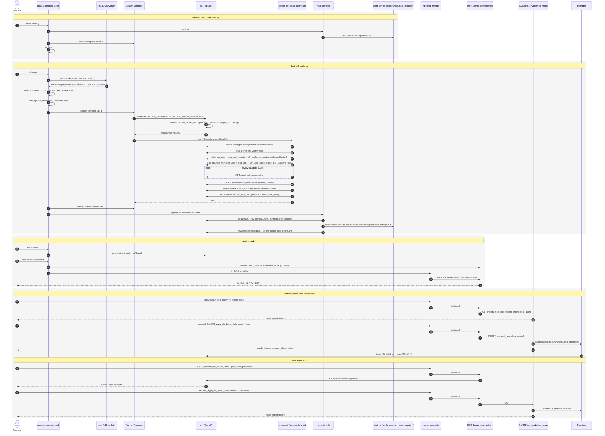

# Architecture

## Purpose

This repository packages a **repeatable local environment** for:

1. Running **Splunk Enterprise** in Docker with the **Splunk MCP Server** application from Splunkbase.
2. Provisioning a dedicated Splunk user suitable for MCP tool execution.
3. Wiring **Claude Desktop**, **Claude Code**, and **Cursor** via **`npx mcp-remote`** (encrypted bearer token in a mode-600 header file, passed with **`--header-file`**).

It is a **proof-of-concept**: fast iteration on Splunk + LLM tooling, not a production deployment template.

## Why MCP here

The [Model Context Protocol](https://modelcontextprotocol.io/) lets a client (Claude, Cursor) discover tools and resources exposed by a server. Splunk’s MCP Server app exposes Splunk operations through `/services/mcp`. This repo automates:

- Installing dependencies (Splunkbase downloads at container start).
- Post-start configuration (SSL verify flag for dev, user/role/token).
- MCP client configuration pointing at a mode-600 header file that holds the encrypted bearer token (outside the repo, not committed).

## Splunkbase applications

`compose.yml` sets `SPLUNK_APPS_URL` to a comma-separated list of package download URLs. Installed from Splunkbase: **SA-Eventgen** (1924), **Config Explorer** (4353), **Splunk MCP Server** (7931), **Splunk AI Assistant** (7245), and the **Splunk Common Information Model** (1621, provides the `Web` data model SA-S4R maps to). **SA-S4R** is installed from this repo’s GitHub Release **`latest`** (`SA-S4R.spl`). Pin details and the full table live in [CONFIGURATION.md](CONFIGURATION.md#composeyml).

You need valid **Splunkbase** credentials in **`.env`** (or the process environment): **`SPLUNKBASE_USER`** and **`SPLUNKBASE_PASS`**.

## Client connections

Per [Splunk MCP Server 2.0](https://help.splunk.com/en/splunk-cloud-platform/mcp-server-for-splunk-platform/2.0/connecting-to-the-mcp-server-and-settings) (product docs; this repo implements **local Enterprise** only), **Claude** and **Cursor** use **`npx mcp-remote`** to **`https://localhost:8089/services/mcp`** with an **encrypted** bearer token (`make update-mcp-clients` or **`make up`** with **`MCP_UPDATE_ON_BOOT`**). **Splunk Cloud** MCP is **out of scope** — see [README.md](README.md#scope).

## Secrets flow

1. Copy **`.env.example`** to gitignored **`.env`** and fill the four required secrets. Non-secret settings are in tracked **`config.env`**.
2. **`make up`** sources **`.env`** when it exists. CI can export the same variables instead.
3. **Clients:** tokens minted by **`scripts/mint-mcp-token.sh`** after **`splunk-init`**; stored only in the header file **`~/.config/splunk-mcp/headers`** (mode 600). Client configs hold its path, so the token is not in process arguments.

## Sample data (SA-S4R)

The **SA-S4R** app ships **Eventgen** configuration for synthetic **`access_combined`** events in **`main`**. See [SA-S4R-APP.md](../s4r/SA-S4R-APP.md) and workshop hub [s4r/README.md](../s4r/README.md).

| Mode | Preferred (MCP) | Shell fallback | Narrative |
| ---- | ----------------- | -------------- | --------- |
| Infrastructure (default) | **`SA-S4R_apply_nk_demo_state`** (`mode=infrastructure`) | `make s4r-attack-nk-disable` | Uniform ~40% errors (503/404); IT Ops leads |
| Active threat (optional) | **`SA-S4R_apply_nk_demo_state`** (`mode=threat`) | `make s4r-attack-nk-enable` | NK geo on failed purchases; Security leads |

Check mode: **`SA-S4R_query_nk_demo_state`**. Agentic analysis: [AGENTS.md](../s4r/AGENTS.md).

## System components

### 1. Splunk Enterprise Container (so1)

- **Image**: `SPLUNK_IMAGE` in tracked **`config.env`** (Compose requires it)
- **Platform**: `linux/amd64`
- **Ports**:
  - `8000`: Splunk Web UI
  - `8089`: Splunk Management API / MCP Server endpoint
- **Health Status**: Uses embedded Splunk healthcheck
- **Restart Policy**: Always (auto-restart if container crashes)

### 2. Splunk Initialization Container (splunk-init)

- **Image**: `alpine:3.21` (installs `curl`, `jq`, and `bash` at container start)
- **Purpose**: Runs initialization setup script after Splunk is healthy
- **Dependency**: Waits for `so1` service to be healthy
- **Restart Policy**: No (runs once and stops)
- **Script**: `scripts/setup-splunk.sh` (REST defaults from `scripts/splunk-api-env.sh`; Compose sets `SPLUNK_HOST=so1`)

### 3. Data Persistence

#### Named Volumes

- **so1-var**: Stores Splunk variable data
  - Indexes (add **`claude_logs`** yourself if you want Claude Desktop log ingestion)
  - Logs
  - KV Store data
  
- **so1-etc**: Stores Splunk configuration files
  - User configs
  - App configurations
  - Authorization settings

#### Bind Mounts

- **Claude logs (optional)**: In `compose.yml`, uncomment  
  `${HOME}/Library/Logs/Claude:/var/log/claude_logs`  
  on macOS so logs are visible inside the container. The minimal **`setup-splunk.sh`** does **not** create the index or monitor; configure those in Splunk if you enable this mount.

#### Local Files

- **compose.yml**: Docker Compose configuration
- **.env.example**: Tracked template with empty secret values
- **.env**: Gitignored runtime file, copied from **`.env.example`** and filled locally
- **SA-S4R/**: Sample Splunk app source. Compose installs the published **`SA-S4R.spl`** into `$SPLUNK_HOME/etc/apps` (no app bind mount). **`splunk-init`** still bind-mounts **`default/s4r_mcp_tools.json`** read-only.

### 4. Claude Logs Index

- **Index Name**: `claude_logs` — create in Splunk if you want this data (`setup-splunk.sh` does not create it)
- **Data Source**: Host path mounted into the container **only if** you enable the bind mount above
- **Purpose**: Optional capture of Claude Desktop logs into Splunk
- **Monitoring**: Add a Splunk **monitor** input on `/var/log/claude_logs` after the mount is active
- **Retention**: Follows Splunk default retention policies

### 5. Network

- **Type**: Bridge network (`splunk`)
- **Services**: so1, splunk-init
- **DNS**: Container names resolve within the network

## Initialization Flow

```text
make up
  ├─ .env missing on macOS: env-from-keychain.sh (S4R-demo + splunkbase)
  ├─ docker compose up -d (secrets from .env, or the process environment when .env is absent)
  │  ├─ so1 (Splunk)
  │  │  ├─ Pull image
  │  │  ├─ Start container
  │  │  ├─ Install apps from SPLUNK_APPS_URL
  │  │  └─ Wait for health
  │  └─ splunk-init (waits for so1 healthy)
  │     └─ setup-splunk.sh
  │        ├─ Enable Eventgen modinput (required; init fails if still disabled)
  │        ├─ Create/update role: mcp_user (mcp_tool_execute, s4r_workshop_control, srchJobsQuota=5)
  │        ├─ Create user: splunker
  │        └─ register-s4r-mcp-tools (wait for KV Store, POST /services/mcp_tools for SA-S4R)
  └─ host (after splunk-init exits 0)
     └─ update-all (MCP_UPDATE_ON_BOOT; mint token into header file, point client configs at it, revoke older tokens)
```

**Shutdown:** `make down` runs **`mcp-client.sh park all`** first (removes `splunk-mcp-server` from client configs and deletes the header file) so clients do not reconnect with stale tokens during the next boot.

### End-to-end sequence

A full run from a wiped stack: teardown, boot, health checks, then the SA-S4R workshop tools called as **`splunker`** through **`npx mcp-remote`**. Reading the mode needs **`mcp_tool_execute`**; changing it needs **`s4r_workshop_control`**.



## Security Architecture

### Authentication Layers

1. **Container to Container**: Network isolation via bridge network
2. **API Authentication**:
   - Admin operations: Username/password (admin user)
   - MCP operations: Bearer token from `scripts/mint-mcp-token.sh` in the header file the client config points at
3. **Transport Security**: HTTPS with self-signed certificates (localhost only)
4. **Credential Management**: gitignored `.env` (or exported variables in CI)

### User Roles

| User | Role(s) | Auth | Scope | Expiry |
| ---- | ------- | ---- | ----- | ------ |
| `splunker` | `user`, `mcp_user` (holds `mcp_tool_execute` and `s4r_workshop_control`), `s4r_user` (allowed role of the `SA-S4R_*` tools) | Bearer token (MCP) | MCP (PoC) | Per Splunk MCP / token policy |
| `admin` | Built-in | Password | Full admin | N/A |

The setup script assigns Splunk role **`mcp_user`** with capabilities **`mcp_tool_execute`** and **`s4r_workshop_control`** (init fails if either grant fails) and **`srchJobsQuota=5`**, so parallel S4R agents do not queue. It does **not** grant **`admin`** to the MCP user (add manually in Splunk only if you accept the risk).

### Environment variables

Supplied to Compose via gitignored **`.env`**, or via the process environment when that file is absent. Example shape:

```bash
SPLUNK_ADMIN_PASSWORD=<secret>
SPLUNKBASE_USER=<splunkbase user>
SPLUNKBASE_PASS=<splunkbase password>
SPLUNK_SPLUNKER_PASSWORD=<secret>
```

`SPLUNK_IMAGE` and `TZ` are in tracked **`config.env`**.

**Splunk Enterprise build** is determined by the pinned Docker image tag in **`config.env`** (currently `splunk/splunk:10.6.1`; verify with Splunk Web **Settings → Server settings** or `services/server/info`). **Splunk MCP Server** app builds are pinned by **`SPLUNK_APPS_URL`** in `compose.yml` (Splunkbase download URLs). When bumping the image across major versions, wipe compatible Docker volumes first as described in [CONFIGURATION.md § Version bump workflow](CONFIGURATION.md#version-bump-workflow).

## Claude Desktop Integration

### Connection Flow

```text
Claude Desktop
      │
      ├─ Reads: ~/Library/Application Support/Claude/claude_desktop_config.json (macOS)
      │
      └─ Spawns: npx mcp-remote → https://localhost:8089/services/mcp --header-file <path to encrypted bearer token>
```

### Token Management

- **Generation**: After **`splunk-init`** exits, the host runs **`scripts/mint-mcp-token.sh`** (admin REST → Splunk MCP Server **`/services/mcp_token`**: create the encryption key pair if missing, then a token for **`splunker`**). **`setup-splunk.sh` does not mint tokens.**
- **Storage**: Header file only (`SPLUNK_MCP_HEADER_FILE`, default `~/.config/splunk-mcp/headers`, mode 600). Client configs hold its path; neither is in the repo.
- **Expiry**: Splunk MCP Server 2.1 caps every token at the encryption key's validity (key default 180 days, max 365). When the key expires, **all** tokens stop working until the key is rotated (see **`docs/poc/TROUBLESHOOTING.md`**).
- **Renewal**: Re-run `make update-mcp-clients` to mint a new token; every configured client picks it up from the header file.

## Configuration Files

### compose.yml

- Docker Compose service definitions
- Volume mounts
- Network configuration
- Environment variables

### setup-splunk.sh

- Creates or updates Splunk role **`mcp_user`** with capabilities **`mcp_tool_execute`** and **`s4r_workshop_control`** (after an SA-S4R reload) and **`srchJobsQuota=5`**
- Creates **`splunker`** with roles **`user`** + **`mcp_user`** + **`s4r_user`** (`s4r_user` comes from SA-S4R 1.1.1+; left out with a warning if the app lacks it)
- Via **`register-s4r-mcp-tools.sh`**: limits the five **`SA-S4R_*`** tools to **`s4r_user`** with Tool Role Policies, when the role exists and `splunker` holds it
- Uses `SPLUNK_SPLUNKER_PASSWORD` (env) for the MCP user (no password written to disk)
- REST host, port, and account names come from `scripts/splunk-api-env.sh` (`localhost`, `8089`, `admin`, `splunker` unless already set)
- Enables SA-Eventgen default modinput (**required**; init fails if missing or still disabled)
- Registers SA-S4R MCP tools via **`scripts/register-s4r-mcp-tools.sh`** before init exits
- Dependencies: `curl`, `jq`, `bash` (installed in `splunk-init`)

Host **Claude** / **Cursor** configs are updated by **`scripts/mcp-client.sh`** via **`make update-mcp-clients`** or **`make up`** (`MCP_UPDATE_ON_BOOT`, default **`cursor claude-code`**), not by this script. TLS overrides are described in **`docs/poc/CONFIGURATION.md`**.

### Makefile

- Automation targets
- Docker command shortcuts

## Data Flow

### Splunk Startup

1. Container starts with environment variables
2. Splunk accepts license and terms
3. Splunk MCP Server app is installed
4. Splunk services start
5. Healthcheck begins

### Initialization

1. splunk-init waits for healthcheck to pass
2. Runs setup-splunk.sh (roles, MCP user, Eventgen, SA-S4R tool registration — no token mint)
3. splunk-init container exits (`restart: "no"`)
4. Host runs `update-all` (`MCP_UPDATE_ON_BOOT`) → mints a bearer token into the header file, points client configs at it, and revokes superseded tokens

### MCP Operation

1. Client spawns **`npx mcp-remote`** with streamable HTTP to `/services/mcp`; it reads the encrypted bearer token from the header file
2. Splunk MCP Server processes the request
3. Built-in tools (`splunk_*`, `saia_*`) and **app tools** (`SA-S4R_*`) execute as **`splunker`**
4. Response is returned to the client

### App-augmented MCP tools (SA-S4R)

[MCP Server 2.0](https://help.splunk.com/en/splunk-cloud-platform/mcp-server-for-splunk-platform/2.0/about-mcp-server-for-splunk-platform) exposes **SPL** or **API** tools through one Splunk MCP Server. **SA-S4R** registers them inside **`splunk-init`**: `POST /services/mcp_tools` from `s4r_mcp_tools.json`, then enable each tool. Execution still calls a saved search or the workshop-mode REST handler. See [Managing custom tools](https://help.splunk.com/en/splunk-cloud-platform/mcp-server-for-splunk-platform/2.0/managing-custom-tools-in-splunk-mcp-server).

Definitions, file map, and tool catalog: [MCP-TOOLS.md](../s4r/MCP-TOOLS.md). Workshop data: [SA-S4R-APP.md](../s4r/SA-S4R-APP.md).

## Scalability Considerations

### Current Limitations

- Single Splunk instance (no clustering)
- Local filesystem persistence
- Single MCP endpoint
- Self-signed certificates (localhost only)

### Future Enhancements

- Splunk clustering for HA
- External volume storage
- Multiple MCP endpoints
- Certificate management
- Load balancing

## Disaster Recovery

### Data Backup

```bash
# Backup volumes
docker run --rm -v so1-var:/data -v ~/backups:/backup \
  alpine tar czf /backup/so1-var.tar.gz -C /data .

docker run --rm -v so1-etc:/data -v ~/backups:/backup \
  alpine tar czf /backup/so1-etc.tar.gz -C /data .
```

### Recovery Process

1. Remove current containers: `make down`
2. Remove volumes: `docker volume rm so1-var so1-etc`
3. Restore backups to volumes
4. Start services: `make up`

## Performance Tuning

### Resource Requirements

- **Minimum**: 2 CPU cores, 4GB RAM
- **Recommended**: 4+ CPU cores, 8GB RAM
- **Optimal**: 8+ CPU cores, 16GB RAM

### Volume Performance

- Named volumes: Better performance than bind mounts
- so1-var: Heavy I/O for indexing
- so1-etc: Moderate I/O for configs

## Troubleshooting Architecture

### Container Health

- `docker compose ps`: Check service status
- `make logs`: View real-time logs
- `docker inspect <container>`: Detailed inspection

### Network Issues

- `docker network inspect splunk`: Network details
- `docker exec so1 ifconfig`: IP configuration
- `docker exec so1 curl -k https://localhost:8089`: API connectivity

### Volume Issues

- `docker volume inspect so1-var`: Volume details
- `docker volume inspect so1-etc`: Permissions check
- `docker exec so1 df -h`: Disk space usage

## Related reading

- [CONFIGURATION.md](CONFIGURATION.md) — Compose, env, clients, `setup-splunk.sh` appendix
- [SPECS.md](SPECS.md) — requirements and acceptance criteria
- [SECURITY.md](SECURITY.md) — threat model and limitations
- [TROUBLESHOOTING.md](TROUBLESHOOTING.md) — failures and recovery
- [s4r/README.md](../s4r/README.md) — Splunk4Rookies workshop docs
- [MCP-TOOLS.md](../s4r/MCP-TOOLS.md) — how SA-S4R registers MCP tools
