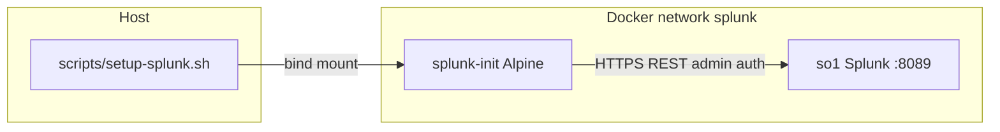
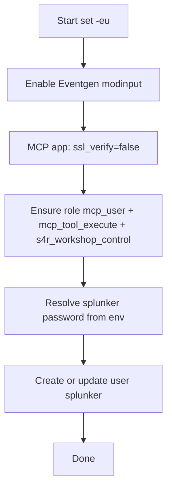

## compose.yml

**`SPLUNK_APPS_URL`** in **`compose.yml`** is a comma-separated list of package download URLs; the **`compose.yml`** comments identify each app. Splunkbase entries (app ID → name):

| App ID | App | Pinned release |
| ------ | --- | -------------- |
| 1924 | SA-Eventgen (sample data / Eventgen modinput) | 8.2.2 |
| 4353 | Config Explorer (optional UI utility) | 1.8.26 (Splunkbase lists Splunk up to 10.4; runs on 10.6 but not declared) |
| 7931 | Splunk MCP Server (required for `/services/mcp`) | 2.0.0 |
| 7245 | Splunk AI Assistant | 2.3.3 |
| — | SA-S4R (this repo) | GitHub Release [`latest`](https://github.com/dd-Splunk/splunk-mcp/releases/download/latest/SA-S4R.spl) |

Check current Splunkbase releases: `https://splunkbase.splunk.com/api/v1/app/<id>/release/` (first entry is latest). Update the `/release/VERSION/` segment in **`compose.yml`** when bumping.

### Version bump workflow

Use this when changing the Splunk Enterprise image, Splunkbase app pins, or the `mcp-remote` bridge package.

1. **Splunk image**
   - Update **`SPLUNK_IMAGE`** in **`config.env`**. Compose requires that value (`${SPLUNK_IMAGE:?…}`).
   - For Cursor Cloud or any persistent Docker volume created by another major version, run **`./scripts/cloud-bootstrap.sh --wipe`** or **`make clean-y`** before the first boot to avoid stale KVStore data.
2. **Splunkbase apps**
   - Run **`make check-splunkbase-pins`** (or open `https://splunkbase.splunk.com/api/v1/app/<id>/release/` — first `name` is latest).
   - Replace only the `/release/VERSION/` segment in **`SPLUNK_APPS_URL`** unless the app ID changes.
   - Keep the comments beside **`SPLUNK_APPS_URL`** current so troubleshooting can map a failed URL back to an app.
   - Keep the pin table in this section in sync with `compose.yml`.
3. **`mcp-remote`**
   - Change **`MCP_REMOTE_PACKAGE`** only when a client-side bridge update is needed; the Makefile default is the repo-wide default.
   - Re-run **`make update-mcp-client MCP_CLIENT=<client>`** after changing the package so client configs pick up the new spec.
4. **Verification**
   - Start from a clean or compatible volume set, then run **`make up`** and **`make verify`**.
   - If a Splunkbase URL returns 404, confirm credentials first, then refresh the affected release segment from Splunkbase.

### Service `so1` (Splunk)

| Setting | Meaning |
| ------- | ------- |
| `image` | `${SPLUNK_IMAGE}` from **`config.env`** |
| `platform: linux/amd64` | Run x86 image on ARM via emulation when needed |
| `SPLUNK_GENERAL_TERMS` | Accepts Splunk general terms non-interactively |
| `SPLUNK_START_ARGS` | License acceptance |
| `SPLUNK_PASSWORD` | Admin password, mapped from `SPLUNK_ADMIN_PASSWORD` (`.env` or the shell environment). The image only reads this key name |
| `SPLUNKBASE_USERNAME` / `SPLUNKBASE_PASSWORD` | Splunkbase downloads |
| `SPLUNK_APPS_URL` | Comma-separated package URLs (Splunkbase apps plus GitHub **`SA-S4R.spl`**) |
| `TZ` | Container timezone from **`config.env`** |

**Ports**

- `8000` — Splunk Web
- `8089` — REST API and `/services/mcp`

**Volumes**

- Named volumes `so1-var` and `so1-etc` persist Splunk data and config.
- **SA-S4R** is not bind-mounted. The image downloads [GitHub **`latest` `SA-S4R.spl`**](https://github.com/dd-Splunk/splunk-mcp/releases/download/latest/SA-S4R.spl) from **`SPLUNK_APPS_URL`** on the first start of an empty **`so1-etc`**. Recreate that volume to install the app or to pick up a newer package. Workshop edits belong in the installed app’s **`local/`** (inside the volume). Do not bind-mount the app **`:ro`** — the image **chowns** that path and fails with **`Errno 30`**. See [SA-S4R-APP.md](../s4r/SA-S4R-APP.md) § Install from GitHub `.spl`.

**Claude logs (macOS, optional)**

The sample `compose.yml` has this bind mount **commented out**. When enabled, it looks like:

```text
${HOME}/Library/Logs/Claude:/var/log/claude_logs
```

If you are not on macOS or that path does not exist, adjust or remove this mount. **`scripts/setup-splunk.sh`** does **not** create a `claude_logs` index or monitor; add those via Splunk UI or REST if you want host log ingestion.

### Local overrides (optional)

Docker Compose merges **`docker-compose.override.yml`** automatically when present (file is **gitignored**). Create it at the repo root for host-specific ports or mounts instead of editing tracked **`compose.yml`**.

```yaml
services:
  so1:
    # Host ports already in use (default mapping is 8000 / 8089 on localhost)
    ports:
      - "127.0.0.1:9000:8000"
      - "127.0.0.1:9089:8089"
    # macOS: optional Claude Desktop log bind mount (see commented line in compose.yml)
    volumes:
      - ${HOME}/Library/Logs/Claude:/var/log/claude_logs:rw
```

Use only the blocks you need. If you remap **8089**, set **`SPLUNK_MCP_ENDPOINT`** (and re-run **`make update-mcp-clients`**) to the new URL. Do not commit secrets or machine-specific paths.

### Service `splunk-init`

Runs after `so1` is **healthy**. Uses Alpine, installs `curl`, `jq`, and `bash`, then runs `setup-splunk.sh`. Mounts (read-only, under `/opt/splunk-init/`):

- `scripts/setup-splunk.sh`, `scripts/splunk-api-env.sh`, `scripts/with-splunk-env.sh`, `scripts/register-s4r-mcp-tools.sh`
- `SA-S4R/default/s4r_mcp_tools.json` (batch-replace payload)
- No host secrets mount (this repo does not write tokens/passwords to disk). `compose.yml` passes `SPLUNK_ADMIN_PASSWORD`, `SPLUNK_SPLUNKER_PASSWORD`, `FORCE_SPLUNK_SPLUNKER_PASSWORD` (default `0`), `SPLUNK_HOST=so1`, and `SPLUNK_MCP_ENV_LOADED=1`. Port **8089**, REST user **`admin`**, and MCP user **`splunker`** are defaults in `scripts/splunk-api-env.sh`.

### MCP token minting (host)

- **`scripts/wait-splunk-init.sh`** — blocks until the **`splunk-init`** container exits `0` (`compose-up.sh` runs this after `docker compose up`).
- **`scripts/register-s4r-mcp-tools.sh`** — called by **`setup-splunk.sh`** inside **`splunk-init`**: waits up to 5 minutes for the KV Store to be ready, `POST /services/mcp_tools` for **SA-S4R**, then enable each tool.
- **`scripts/mint-mcp-token.sh`** — after init: waits for Splunk API, polls **`mcp_token`**, prints encrypted token to stdout.
- **`make update-mcp-client`** writes the token into Claude / Cursor configs only.

### Network and volumes

- Bridge network **`splunk`** for `so1` ↔ `splunk-init`.
- Named volumes **`so1-var`** and **`so1-etc`** (explicit names in Compose).

## config.env and .env

**`config.env`** is tracked and holds non-secret settings (`SPLUNK_IMAGE`, `TZ`). **`make up`** loads it after secrets, so a copy of those keys in `.env` does not win. Passwords are not stored there.

Copy [`.env.example`](../../.env.example) to **`.env`**, fill the four required values, and run **`make up`**. **`.env`** is gitignored. `chmod 600 .env`. Compose auto-loads it. CI and Cursor Cloud can export the same variables instead of writing a file; host scripts use the process environment when `.env` is absent.

| Situation | Use |
| --------- | --- |
| Local development | Gitignored **`.env`** from **`.env.example`** |
| Local development (macOS) | **`make env`** writes **`.env`** from keychain items (below). **`make up`** does this automatically when `.env` is missing and `SPLUNK_ADMIN_PASSWORD` is not exported. |
| CI or Cursor Cloud | Exported `SPLUNK_ADMIN_PASSWORD`, `SPLUNKBASE_USER`, `SPLUNKBASE_PASS`, and `SPLUNK_SPLUNKER_PASSWORD`. Cloud bootstrap writes a gitignored `.env` from those Splunkbase values and generates the other two passwords when they are unset. |

### `.env` from the macOS keychain

**`scripts/env-from-keychain.sh`** (`make env`) reads two generic-password items and writes a `chmod 600` **`.env`**. It prints no values and keeps an existing `.env` unless **`ENV_FORCE=1`** (`--force`).

| Keychain service | Account | Password | `.env` keys |
| ---------------- | ------- | -------- | ----------- |
| `S4R-demo` (`KEYCHAIN_SPLUNK_SERVICE`) | any | Splunk password | `SPLUNK_ADMIN_PASSWORD`, `SPLUNK_SPLUNKER_PASSWORD` |
| `splunkbase` (`KEYCHAIN_SPLUNKBASE_SERVICE`) | Splunkbase user | Splunkbase password | `SPLUNKBASE_USER`, `SPLUNKBASE_PASS` |

Create the items once; `-w` with no value prompts, so the password stays out of shell history:

```bash
security add-generic-password -s S4R-demo -a "$USER" -U -w
security add-generic-password -s splunkbase -a <splunkbase-user> -U -w
```

Changing the keychain password does not change a running stack: Splunk reads the admin password only on first boot, and `splunker` is reset only with **`FORCE_SPLUNK_SPLUNKER_PASSWORD=1`**. Rotate in Splunk first, then rewrite `.env` with **`make env ENV_FORCE=1`**.

### Typical variables

| Variable | Purpose | Where |
| -------- | ------- | ----- |
| `SPLUNK_IMAGE` | Splunk Docker image tag | `config.env` |
| `TZ` | Container timezone | `config.env` |
| `SPLUNK_ADMIN_PASSWORD` | Admin password | `.env` or the environment |
| `SPLUNKBASE_USER` / `SPLUNKBASE_PASS` | Splunkbase (names in `compose.yml` map these) | `.env` or the environment |
| `SPLUNK_SPLUNKER_PASSWORD` | Password of Splunk user `splunker` (MCP execution user) | `.env` or the environment |

**Note:** `compose.yml` expects `SPLUNKBASE_USER` and `SPLUNKBASE_PASS` in the environment. Define them in **`.env`**. Variable **names** must match what Compose references.

## Makefile targets

| Target | Behavior |
| ------ | -------- |
| `env` | Write `.env` from keychain items `S4R-demo` + `splunkbase` (macOS). **`ENV_FORCE=1`** overwrites |
| `up` | `scripts/compose-up.sh` (`.env`, the process environment, or on macOS a `.env` built from the keychain; **`splunk-init`** registers SA-S4R tools), then `update-all` (`MCP_UPDATE_ON_BOOT`, default `cursor`) |
| `config` | Print `docker compose config` after the same secret and `config.env` load as `up`. `SPLUNK_ADMIN_PASSWORD`, Splunkbase user/password, and `SPLUNK_SPLUNKER_PASSWORD` are shown as `<set>` |
| `down` | `scripts/mcp-client.sh park all` (no secrets), then `docker compose down`. `config.env` must be present so Compose can read `SPLUNK_IMAGE` and `TZ` |
| `park-mcp-clients` | `scripts/mcp-client.sh park all` — remove `splunk-mcp-server` from client configs |
| `update-mcp-clients` | `scripts/mcp-client.sh update-all` for cursor, claude, claude-code (one mint) |
| `update-mcp-client` | One client: `MCP_CLIENT=claude\|claude-code\|cursor` |
| `verify-mcp-remote` | `scripts/mcp-client.sh verify` — client config + direct `tools/list` + **`npx mcp-remote` stdio** e2e (`MCP_VERIFY_CLIENT=all` by default; `all` skips clients without a `splunk-mcp-server` entry and fails only if none has one) |
| `verify` | Runs `status`, then `verify-mcp-remote` |
| `test` | Docker-free: MCP client JSON/YAML shape (`write-shape` / `verify-config` / `park`) plus SA-S4R mode/payload unit tests |
| `check-splunkbase-pins` | Compare `compose.yml` `SPLUNK_APPS_URL` pins to Splunkbase `api/v1/app/<id>/release/` (no secrets). **MISSING** = next `make up` can 404. **`STRICT=1`** exits 1 on MISSING |
| `demo-prep` | Runs **`check-splunkbase-pins`**, then `status`, then `verify-mcp-remote`, and prints the live-demo warm-stack reminder. Cursor **`/demo-prep`** also runs S4R mode + **`mcp-auth-failures`** |
| `mcp-auth-failures` | Admin `_internal` MCP auth/tool stats (last 30m). Needs `.env` or `SPLUNK_ADMIN_PASSWORD` in the environment. **`DETAIL=1`** prints raw failures. Not visible to `splunker` MCP |
| `cloud-bootstrap` | `scripts/cloud-bootstrap.sh` — Cursor Cloud VM prep before `make up` (`CLOUD_BOOTSTRAP_ARGS` for flags) |
| `restart` / `logs` / `status` | Lifecycle only (no secrets required) |
| `clean` | `scripts/mcp-client.sh park all`, then `docker compose down -v`, then remove `.env` (`config.env` must be present). Prompts unless **`make clean-y`** or **`CLEAN_YES=1`** |
| `clean-y` | Non-interactive **`clean`** (for automation, e.g. `make clean-y && make up`) |
| `s4r-attack-nk-enable` | **Shell fallback:** `POST` `disabled=false` on the NK Eventgen stanza, then reload Eventgen. Prefer MCP **`SA-S4R_apply_nk_demo_state`** (`mode=threat`) — no restart on HTTP **200**; HTTP **503** or a shell reload error → follow the printed hint (**`make restart`**, or **`make up`** if Eventgen was left disabled). Needs `.env` or `SPLUNK_ADMIN_PASSWORD` in the environment |
| `s4r-attack-nk-disable` | **Shell fallback:** `POST` `disabled=true`, then reload Eventgen. Prefer MCP **`SA-S4R_apply_nk_demo_state`** (`mode=infrastructure`) |
| `s4r-attack-nk-status` | **Shell fallback:** prints NK stanza enabled/disabled from Splunk properties REST. Prefer MCP **`SA-S4R_query_nk_demo_state`**. Needs `.env` or `SPLUNK_ADMIN_PASSWORD` in the environment |
| `marp-preview` / `marp-serve` / `marp-html` | Preview, serve, or export the S4R presenter deck under `demo-slides/` |

Workshop behavior and validation SPL: **[SA-S4R-APP.md](../s4r/SA-S4R-APP.md)** (Workshop modes). Marp deck mechanics: **[demo-slides/README.md](../../demo-slides/README.md)**.

## scripts/setup-splunk.sh

Summary of what runs **inside** `splunk-init` with `SPLUNK_HOST=so1`:

1. Enables the **SA-Eventgen** default modular input (**required**; init **exits 1** if the app is missing or the input stays disabled).
2. Sets MCP server `ssl_verify=false` via REST (dev convenience).
3. Ensures Splunk role **`mcp_user`** exists with capability **`mcp_tool_execute`** and **`srchJobsQuota=5`** (parallel S4R agent headroom).
4. Creates or updates user **`splunker`** with roles **`user`** + **`mcp_user`**, and clears **`locked-out`** (idempotent unlock on every init).
5. Registers SA-S4R MCP tools from `s4r_mcp_tools.json` (`POST /services/mcp_tools`, enable, saved-search reload). Init **exits 1** if that fails.
6. Uses `SPLUNK_SPLUNKER_PASSWORD` from env; this repo does not write passwords to disk.

**Full reference** (REST tables, diagrams, idempotency): [Appendix: setup-splunk.sh](#appendix-setup-splunksh).

## Splunk MCP authentication (2.0)

This PoC automates **encrypted bearer tokens** for **local Splunk Enterprise** at **`https://localhost:8089/services/mcp`** only. **Splunk Cloud** MCP (OAuth, remote endpoints) is **out of scope** for this repo — use Splunk product docs if you need Cloud.

Official references (product documentation; URLs say “cloud-platform” but apply to MCP Server **2.0** generally):

- [About MCP Server (2.0)](https://help.splunk.com/en/splunk-cloud-platform/mcp-server-for-splunk-platform/2.0/about-mcp-server-for-splunk-platform)
- [Connecting and settings (2.0)](https://help.splunk.com/en/splunk-cloud-platform/mcp-server-for-splunk-platform/2.0/connecting-to-the-mcp-server-and-settings)

### Encrypted bearer token (this repo)

| Aspect | Detail |
| ------ | ------ |
| **When** | Local Enterprise Docker PoC, workshops, Claude Desktop, Claude Code, Cursor, or any client using **`npx mcp-remote`** |
| **How** | Mint encrypted token (MCP app UI or **`scripts/mint-mcp-token.sh`** → `mcp_token` REST); client sends **`Authorization: Bearer <token>`** |
| **Automation** | **`make update-mcp-clients`** writes token into client configs only (not git) |
| **Splunk side** | User needs **`mcp_tool_execute`**; token mint via admin REST uses MCP app **`mcp_token`** endpoint |
| **Security** | Encrypted tokens work **only** for MCP (not general Splunk REST); rotate via MCP app; **Invalidate Keys** revokes all encrypted tokens |

Client shape matches Splunk’s 2.0 sample: **`npx mcp-remote`**, streamable HTTP endpoint, bearer header. For self-signed localhost certs, server **`ssl_verify=false`** (setup script) plus client **`NODE_TLS_REJECT_UNAUTHORIZED=0`** when **`SPLUNK_MCP_TLS_INSECURE=1`**.

Do not store Cloud MCP bearer tokens in **`.env`** — that file is for **stack boot** secrets only (`SPLUNK_ADMIN_PASSWORD`, Splunkbase, `SPLUNK_SPLUNKER_PASSWORD`). MCP runtime tokens belong in client config (**.cursor/mcp.json**), minted by **`make update-mcp-clients`**.

## Claude Desktop configuration

- Path: **`~/Library/Application Support/Claude/claude_desktop_config.json`** (macOS).
- Matches Splunk MCP Server **2.0** [client configuration](https://help.splunk.com/en/splunk-cloud-platform/mcp-server-for-splunk-platform/2.0/connecting-to-the-mcp-server-and-settings): **`npx mcp-remote`**, endpoint **`https://localhost:8089/services/mcp`**, **`Authorization: Bearer`** with an **encrypted** token.
- `make update-mcp-client MCP_CLIENT=claude` mints the token via **`scripts/mint-mcp-token.sh`** (Splunk app `mcp_token` REST). Splunk must be up. Token is stored **only** in Claude’s config, not in this repo. The file is **`chmod 600`** after each update or park.
- **`NODE_TLS_REJECT_UNAUTHORIZED=0`** is written when **`SPLUNK_MCP_TLS_INSECURE`** is `1` (default for this PoC; self-signed Splunk only). Set **`SPLUNK_MCP_TLS_INSECURE=0`** to omit `env` if using proper TLS.
- Uses **`jq`**; backs up invalid JSON with a timestamped file.

## Cursor configuration

- Default output: **`.cursor/mcp.json`** (override with `CURSOR_MCP_JSON`; gitignored if it contains a live token). **`chmod 600`** after each update or park.
- Same **2.0** `npx mcp-remote` entry as Claude (**`make update-mcp-client MCP_CLIENT=cursor`**); endpoint **`https://localhost:8089/services/mcp`** only.
- Example shape: **`.cursor/mcp.json.example`** (see Splunk doc link in Claude section above).
- **Cloud-synced workspaces (OneDrive, iCloud, Dropbox):** gitignore does **not** stop the sync client from uploading **`.cursor/mcp.json`**. Prefer a workspace that is not cloud-synced, or set **`CURSOR_MCP_JSON`** to a path outside the synced tree. `chmod 600` only limits local UNIX sharing; the file can still leave the machine via sync.

## Claude Code configuration

- Default output: **`.mcp.json`** at the repo root (Claude Code project scope; override with `CLAUDE_CODE_MCP_JSON`). Gitignored, **`chmod 600`** after each update or park.
- Same **2.0** `npx mcp-remote` entry as Cursor (**`make update-mcp-client MCP_CLIENT=claude-code`**); endpoint **`https://localhost:8089/services/mcp`** only. **`make down`** parks it like the other clients.
- Claude Code reads project servers when a session starts in the repo and asks you to approve **splunk-mcp-server** once. Check with **`/mcp`**.
- **`~/.claude.json`** is not written: Claude Code rewrites that file while it runs.
- Same cloud-sync caveat as **`.cursor/mcp.json`** above.

## Environment overrides (optional)

| Variable | Used by | Purpose |
| -------- | ------- | ------- |
| `SPLUNK_MCP_ENDPOINT` | `mcp-client.sh` | Splunk MCP URL for `mcp-remote` (default `https://localhost:8089/services/mcp`) |
| `SPLUNK_MCP_TLS_INSECURE` | `mcp-client.sh` | If `1` (default), add `NODE_TLS_REJECT_UNAUTHORIZED=0` to the Claude/Cursor config `env` (dev/self-signed only) |
| `MCP_REMOTE_PACKAGE` | `mcp-client.sh` | npm package for `npx` (default `mcp-remote@0.8.3`) |
| `MCP_NPX_COMMAND` | `mcp-client.sh` | Absolute path to `npx` when GUI apps lack Node on `PATH` |
| `CURSOR_MCP_JSON` | `mcp-client.sh` (cursor) | Output path |
| `CLAUDE_MCP_JSON` | `mcp-client.sh` (claude) | Output path (default macOS Claude Desktop config) |
| `CLAUDE_CODE_MCP_JSON` | `mcp-client.sh` (claude-code) | Output path (default `.mcp.json` at the repo root) |
| `MCP_SHAPE_TOKEN` | `mcp-client.sh write-shape` | Fixture token for Docker-free shape tests (not a live Splunk token) |
| `MCP_CLIENT` | `update-mcp-client` | `claude`, `claude-code`, or `cursor` |
| `MCP_VERIFY_CLIENT` | `verify-mcp-remote` | `all` (default), or one client |

## Cursor Cloud bootstrap

Cursor Cloud VMs (Docker-in-Docker, no systemd) need one-time **per-boot** setup before `make up`. Use:

```bash
./scripts/cloud-bootstrap.sh    # or: make cloud-bootstrap
make up
make verify
```

**Prerequisites (`.env` creation):** set **`SPLUNKBASE_USER`** and **`SPLUNKBASE_PASS`** in the environment (Cursor Cloud secrets). Bootstrap writes gitignored **`.env`**. It reuses **`SPLUNK_ADMIN_PASSWORD`** and **`SPLUNK_SPLUNKER_PASSWORD`** when those are already set, and generates them otherwise.

### What bootstrap writes

| File | Source | Notes |
| ---- | ------ | ----- |
| `.env` | Splunkbase values from the environment. Admin and splunker passwords are reused when set, otherwise generated | Gitignored. Existing file is preserved unless **`--force-env`** is used. Use it locally for Splunk Web admin login; never paste or commit it. |
| `docker-compose.override.yml` | Generated every run | Gitignored. Binds the ext4 mount as `so1-var`; for Splunk 10.x, also binds the fake cgroup tree. |

`--wipe` resets Splunk data and Compose volumes but does not recreate `.env` unless paired with **`--force-env`**. Use **`--force-env`** intentionally when rotating generated admin or splunker passwords.

| Flag / env | Purpose |
| ---------- | ------- |
| `--wipe` | Reformat ext4 Splunk data + `docker compose down -v` (use when changing Splunk major versions) |
| `--image IMAGE` / `SPLUNK_IMAGE` | Default `splunk/splunk:10.6.0` |
| `--force-env` | Recreate gitignored `.env` |
| `SPLUNKBASE_USER` / `SPLUNKBASE_PASS` | Required in the environment when creating `.env` |
| `CLOUD_SPLUNKDB_MOUNT` | Default `/mnt/splunkdb` (bind-mounted as `so1-var`) |

Writes gitignored **`docker-compose.override.yml`** (ext4 bind + fake cgroup for 10.x). Full notes: [AGENTS.md](../../AGENTS.md) § Cursor Cloud.

## See also

- [ARCHITECTURE.md](ARCHITECTURE.md) — how pieces fit together
- [SECURITY.md](SECURITY.md) — TLS and token handling
- [TROUBLESHOOTING.md](TROUBLESHOOTING.md) — when ports or inject fail

---

## Appendix: setup-splunk.sh

Reference for **[`scripts/setup-splunk.sh`](../../scripts/setup-splunk.sh)**: configuration, idempotent behavior, environment variables, and REST flow.

### Purpose

The script bootstraps a **local Splunk Enterprise PoC** so that:

1. The **Splunk MCP Server** app is configured for local dev (e.g. **`ssl_verify=false`** on the app).
2. **SA-Eventgen** sample data **must** run via the default modular input (init **fails** if the app is missing or still disabled).
3. Splunk has a dedicated **MCP execution identity**: role **`mcp_user`** (capability **`mcp_tool_execute`**) and user **`splunker`**. Token minting is **`scripts/mint-mcp-token.sh`** after **`splunk-init`** (not in this script).

The script is **`/bin/sh`**, uses **`set -eu`**, and talks to Splunk only through **HTTPS REST** (`curl -k` for local dev).

**Out of scope:** **`claude_logs`** index and monitors—add them in Splunk if you enable the bind mount (see **Claude logs (macOS, optional)** under `compose.yml` above). MCP token minting stays on the host (**`scripts/mint-mcp-token.sh`**).

### Where it runs

Compose starts **`splunk-init`** **after** `so1` is healthy. That container installs `curl`, `jq`, and `bash`, then executes this script (which registers SA-S4R MCP tools before it exits). See [`compose.yml`](../../compose.yml). After editing `s4r_mcp_tools.json`, **`make up`** starts the exited init container again.



Typical environment inside `splunk-init` (from Compose):

| Variable | Example | Role |
| -------- | ------- | ---- |
| `SPLUNK_HOST` | `so1` | REST hostname on the Docker network. The script default is `localhost`, which is this container |
| `SPLUNK_ADMIN_PASSWORD` | *(secret)* | REST password |
| `SPLUNK_SPLUNKER_PASSWORD` | *(secret)* | Password of the MCP execution user (`splunker`) |

### Configuration variables

| Variable | Default | Meaning |
| -------- | ------- | ------- |
| `SPLUNK_HOST` | `localhost` | REST host (`scripts/splunk-api-env.sh`; Compose sets `so1` on `splunk-init`) |
| `SPLUNK_PORT` | `8089` | REST port (`scripts/splunk-api-env.sh`) |
| `SPLUNK_REST_USER` | `admin` | Authenticated user for REST (`scripts/splunk-api-env.sh`) |
| `SPLUNK_ADMIN_PASSWORD` | *(required)* | Admin password |
| `SPLUNK_MCP_USER` | `splunker` | Splunk user to create or update (`scripts/splunk-api-env.sh`) |
| `SPLUNK_SPLUNKER_PASSWORD` | *(required in this repo)* | Password of the MCP execution user (`splunker`) |
| `SPLUNK_CURL_CONNECT_TIMEOUT` | `10` | curl `--connect-timeout` seconds for REST calls (`scripts/splunk-api-env.sh`) |
| `SPLUNK_CURL_MAX_TIME` | `60` | curl `--max-time` seconds per REST call (`scripts/splunk-api-env.sh`) |

Secrets come from gitignored **`.env`** or variables already in the environment. Host, port, and account names come from `scripts/splunk-api-env.sh`. A value already in the environment is kept when `.env` does not set it; keys in `.env` override the environment.

### Execution order



### REST interactions

The script uses **basic auth** on every `auth_curl` call: `-u "admin:${SPLUNK_ADMIN_PASSWORD}"` with `curl -k`.

| Step | Method | Path (relative to `https://HOST:PORT`) | Notes |
| ---- | ------ | ---------------------------------------- | ----- |
| Eventgen | POST | `/servicesNS/nobody/SA-Eventgen/data/inputs/modinput_eventgen/default/enable` | Fallback: same URL with `disabled=0` |
| MCP TLS dev | POST | `/servicesNS/nobody/Splunk_MCP_Server/configs/conf-mcp/server` | Body: `ssl_verify=false` |
| Role | GET/POST | `/services/authorization/roles/mcp_user` | Body: `capabilities=mcp_tool_execute`, `capabilities=s4r_workshop_control`, `srchJobsQuota=5` |
| User | POST | `/services/authentication/users` or `.../users/splunker` | Bodies: `roles=user`, `roles=mcp_user`, `locked-out=false` |

### Helper functions

- **`auth_curl`** — wraps `curl` with admin credentials; 2xx/3xx returns body, else fails.
- **`must`** — runs a command and **`exit 1`** on failure.
- **`splunk_get_json` / `wait_for_disabled_value`** — poll Eventgen stanza (`jq` required; init fails if still disabled).

### Idempotency

Designed so **`make up` / `splunk-init` repeating** does not break: MCP `ssl_verify=false` and role/user updates tolerate re-runs.

### Security notes (dev PoC)

- **`curl -k`** and **`ssl_verify=false`** are **dev-only**; see [SECURITY.md](SECURITY.md).
- Never commit `.env` or client configs with secrets. See [AGENTS.md](../../AGENTS.md).

### Troubleshooting pointers

| Symptom | Likely cause | Where to read more |
| ------- | ------------ | ------------------ |
| “User lacks mcp_tool_execute capability” | `mcp_user` role missing capability | [TROUBLESHOOTING.md](TROUBLESHOOTING.md) |
| Token empty / script exits 1 | MCP app missing or wrong version | Confirm `Splunk_MCP_Server` in `SPLUNK_APPS_URL` |
| No Claude logs | Index/monitor not created | Create index/monitor in Splunk |
| Eventgen enable / verify fails | SA-Eventgen missing or still disabled | Check Splunkbase app 1924; `docker logs so1` / `splunk-init` |
